  
 
<b>Engineering leader who stays hands-on with Python, Artificial Intelligence and automation.</b>
 

 

<a href="#about">About</a> &nbsp;|&nbsp;
<a href="#leadership">Leadership</a> &nbsp;|&nbsp;
<a href="#engineering">Engineering</a> &nbsp;|&nbsp;
<a href="#career">Career</a> &nbsp;|&nbsp;
<a href="#projects">Projects</a> &nbsp;|&nbsp;
<a href="#technology-stack">Technology Stack</a> &nbsp;|&nbsp;
<a href="#get-in-touch">Contact</a>

 

### About

I have spent more than ten years building software and, over that time, more and more of it leading the people who build it. I started with Python storefronts for overseas clients and have since worked across product, architecture, Artificial Intelligence, automation, cybersecurity and mobile, taking projects from requirements all the way to delivery.

Today I lead automation and intelligence work, and I stay close to the engineering. That means production Python and Large Language Model pipelines, along with the parts that keep them honest: logging, retries, audit trails, evaluation before a prompt change, and cost and latency that someone can actually see. The aim is the same on every project. Reduce technical debt, lower cost and ship systems that deliver measurable business value.

 

### Leadership

- **Leading and growing teams.** I manage teams, mentored engineers on backend services and hosting for a fintech application, and wrote the onboarding checklist that new support engineers use for tooling, access and escalation.
- **Planning before patching.** I reduced technical debt by pushing for proper planning up front instead of costly quick fixes.
- **Strategy with senior leadership.** I helped shape Artificial Intelligence strategy with senior leaders, and I set escalation rules, staffing and quality targets for voice and chat workflows together with top management.
- **Proof before commitment.** I lead proof of concept work so stakeholders can judge concrete results before they commit to a project scope.
- **Visibility for decision makers.** I standardized cost, latency and accuracy monitoring for Large Language Model workloads so leadership can track spend, and I raise issues early so timelines stay predictable.
- **Ownership from start to finish.** I have run public-sector Artificial Intelligence projects through requirements, hosting, integrations, deployment and support, and documented a reusable delivery playbook covering procurement, security review and rollout.

 

### Engineering

The hands-on side of the work.

| Area | What I have built |
|:--|:--|
| **Agentic systems** | Bots on the Model Context Protocol with memory, turning plain-language requests into structured, repeatable workflows. Early research ideas stress-tested with parallel Artificial Intelligence agents before resources were committed. |
| **Retrieval-Augmented Generation** | Production pipelines and agents using LangChain, LangGraph, Llama and Claude for financial workflows. An offline chatbot on Redis with fine-tuned quantized models for a national upskilling program. |
| **Prompting and fine-tuning** | Constitutional prompts for document processing that raised accuracy. Fine-tuning with constitutional prompts to improve regulatory detection while cutting processing time. |
| **Governance and observability** | Prompt versioning and evaluation gates that stop regressions before every model or prompt update. A prompt health score that catches drift in production. |
| **Automation** | Bots for full carrier workflows on Amazon Web Services Lambda, with logging, metrics, alerting, Virtual Private Cloud isolation and Single Sign-On. A retry and replay layer for failed steps. Trading bots linking market data to order execution, with an audit log on every action. |
| **Platforms** | Service design and Kubernetes operations for a nationwide learning platform, plus load testing of chatbot endpoints ahead of state-level exam traffic. |

 

### Career

- **2025 to present.** Leading automation and intelligence work: agentic workflows, constitutional prompting, proof of concept delivery and Large Language Model cost and quality monitoring.
- **2024.** Production Retrieval-Augmented Generation pipelines and agents for financial workflows, and Amazon Web Services Lambda bots automating carrier workflows.
- **2022 to 2024.** An offline Retrieval-Augmented Generation chatbot at national scale, public-sector Artificial Intelligence delivery, Kubernetes operations, and mentoring engineers on backend services.
- **2021 to 2022.** Automation bots and rule-based trading bots, with full audit logging.
- **2018 to 2020.** Internal automation, Amazon Web Services scripting, and a dashboard tracking escalation volume and staffing coverage.
- **2015 to 2016.** Python and Flask storefronts for overseas business-to-business clients.

 

### Projects

| Project | Description | Technologies |
|:--|:--|:--|
| **Personal Workspace Application** | Secure workspace for files, notes, to-do lists and user-controlled automations. | Python, Agentic Systems |
| **Education Platform** | Free, global learning platform for Python developers. | Python, Django, PostgreSQL |
| **Short-Video Application** | Scroll-first short-video platform with engagement rewards. | Python, FastAPI, Django, Redis |
| **Quantitative Analytics** | Market scans, signal filtering and machine learning backtesting pipelines. | Python, Pandas, NumPy |
| **Data Recovery Tool** | Reconstruction of data from corrupted storage, validated by Artificial Intelligence with human review. | Python, FastAPI, Django |
| **Resume and Job Description Tooling** | Local tooling for resumes, job descriptions and document workflows. | Python |
| **Android Games** | Interactive games with smooth interfaces and an offline-first design. | Android, Java, Kotlin |

 

### Technology Stack

| Domain | Tools | Practice |
|:--|:--|:--|
| **Languages and Frameworks** |         | Object-oriented programming, backend service design, mobile development |
| **Agents and Orchestration** |     | Agentic systems, memory and planning, tool use, Retrieval-Augmented Generation |
| **Models and Libraries** |      | Fine-tuning, quantized models, constitutional prompting, reinforcement learning |
| **Vector Databases** |      | Embeddings, retrieval, Retrieval-Augmented Generation |
| **Evaluation and Observability** |   | Prompt versioning, evaluation gates, prompt health score, cost, latency and accuracy monitoring |
| **Data and Analytics** |     | Caching, quantitative analysis, backtesting pipelines |
| **Cloud Platforms** |    | Serverless, Virtual Private Cloud isolation, cloud cost cleanup |
| **DevOps** |      | Continuous integration and continuous delivery, load testing, Kubernetes operations |
| **Security and Governance** |    | Single Sign-On, Virtual Private Cloud isolation, client guardrails |
| **Delivery** |    | Agile delivery, proof of concept validation, stakeholder communication |

 

### Recognition

| Certifications | Achievements |
|:--|:--|
| Model Context Protocol Certification | First Place, Robotics Competition |
| Agentic Systems and Automation | Winner, Cybersecurity Competition |
| Reinforcement Learning | |
| Advanced Automation | |
| Machine Learning and Data Science | |

 

### Currently Exploring

- Agentic systems with memory, planning and tool use for enterprise workflows
- Constitutional prompting frameworks for reliable document processing and compliance
- Model Context Protocol bots that translate natural language into structured, repeatable actions
- Cost and quality observability for Large Language Model workloads at scale

 

### Get in Touch

If you are looking for someone who combines hands-on Artificial Intelligence engineering with strategic leadership and a record of shipping measurable outcomes, I would be glad to talk.

<h2>
<b>Email id : r4196c@gmail.com</b>
</h2>
